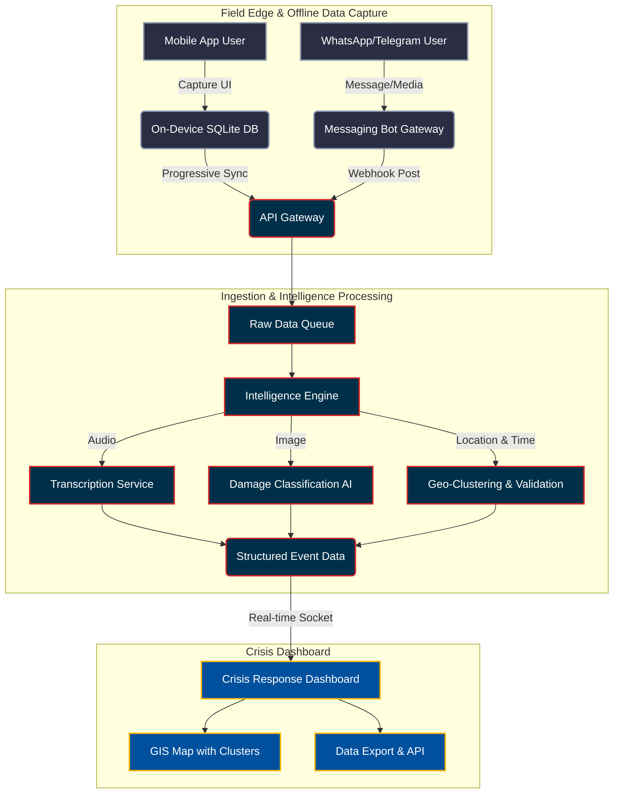
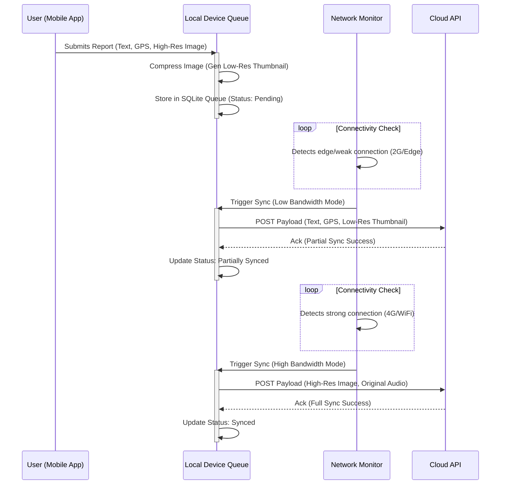

# CRISP Technical Architecture

This document details the architecture for the **CRISP** (Hybrid, Offline-First Community Damage Intelligence Platform).

## 1. High-Level System Architecture

The CRISP ecosystem bridges disconnected field environments with cloud-based intelligence processing.

## 2. Offline-First Progressive Sync Flow

When a reporter submits data in a zero-connectivity environment, CRISP ensures critical data reaches responders as soon as a minimal signal is restored.

## 3. Threat/Trust Validation Model

To prevent misinformation in chaotic post-disaster scenarios, the AI Intelligence Engine calculates a **Confidence Score (0-100%)** for an incident cluster rather than a single report.

*   **Spatial Proximity:** Are there multiple reports within a 50m radius? (+ Confidence)
*   **Temporal Consistency:** Were reports submitted within the same 6-hour window? (+ Confidence)
*   **Visual Similarity:** Does the Image AI detect identical source images (deduplication) vs structurally similar but unidentical images (corroboration)?
*   **User Hash Trust:** Has this distinct device hash submitted verified reports previously?

Reports scoring below 40% are flagged as `Unverified` in the Dashboard. Reports above 80% with visual correlation are flagged as `Verified Priority`.
